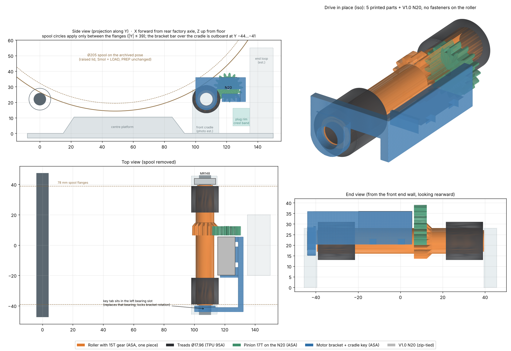

# Poly-Turtle

One BoxTurtle filament lane in a removable, single-spool Polymaker PolyDryer Box. The priorities are to reuse the donor rubber tires, shaft, gears, motor, extruder components and PREP/LOAD switches, keep the spool chamber sealed, and preserve the dryer's docking and airflow.

**Current stage: revision 2c, the cradle drive (CAD + printable parts, not yet bench-tested).** The respool drive sits in the factory front-roller cradles: one printed roller with an integrated gear runs on the factory rod, and the V1.0 N20 drops into a zip-tie bracket. That's 5 printed parts with no fasteners on the roller, and rewind runs at 93 % of V1.0. A TPU tread sized to keep the archived spool pose leaves the spool where it was. The lane LED is dropped. See [cradle drive](docs/cradle-drive.md). **Printed lid rev 3.2**: one piece, printed rim down with no supports. It adds a printed M10 outlet thread with an O-ring seat, a Micro-Fit 2×6 bulkhead, a TPU rim gasket and a magnetic pogo disconnect for the N20, so the lid lifts off with nothing tying it to the box, and has been through a whole-assembly collision, wall-thickness and overhang audit. Jojo's two-port lid base is kept exactly, under a faceted 45° canopy, plus one feeder carrier. Filament climbs the re-posed Smol at 45° from a curved inlet guide. See [printed lid](docs/printed-lid.md). A working conversion has yet to be built or tested.



## Start here

- [Cradle drive: parts, assembly, clearance results and the measurements that confirm it](docs/cradle-drive.md). Printable STLs in [cad/07-cradle-drive](cad/07-cradle-drive/); assembly STEP in `cad/07-Cradle-drive-layout.step.zip`.
- [Printed lid (rev 3.2, one piece, no supports): parts, assembly, checks and inlet routing](docs/printed-lid.md). STLs in `cad/08-Printed-lid.zip`.
- [Final measurements picture guide](docs/measurements/finalize-guide.md) ([printable PDF with record sheet](docs/PolyDryer-Finalize-Guide.pdf)).
- [Molded-box measurements and original photos](docs/measurements/README.md).
- [Illustrated caliper guide and full-size roller template](docs/PolyDryer-Caliper-Guide.pdf). Page 2 prints at 100% on US Letter landscape. Pages 3–6 show where to measure and record readings.
- [Download the entire repository](https://github.com/RyuNinja00/Poly-Turtle/archive/refs/heads/main.zip). Extract it, then run the command below to open the two full-size assemblies or recreate the original fit-study download.
- [CAD file directory](cad/) and [fit findings, assembly instructions and attributions](docs/fit-study.md).
- [Project handoff](docs/handoff.md) for design decisions, unverified assumptions and what to do after measuring the stock box.
- [Build sources and reproduction instructions](build/README.md).

Dimensions are in millimeters. The file marked PROXY represents a third-party printable body. The stock-lid free-volume STEP is a solid representation of empty space.

## Opening the large STEP assemblies

The original 35.5 MB fit-study ZIP is stored byte-for-byte in ordered pieces in [transport](transport/). A clone or the GitHub Download ZIP contains everything required. From the extracted repository run:

```
python transport/restore.py
```

On Windows with the Python launcher, use `py transport/restore.py`. This offline script uses the Python standard library, verifies the original archive checksum, and writes:

- `downloads/PolyDryer-BoxTurtle-Fit-Study.zip`
- `cad/01-Single-lane-fit-study.step`
- `cad/03-Stock-lid-interference-trial.step`

The other STEP/STL files and the illustrated PDF are available individually in the repository. Rebuilding CAD from upstream is optional.
