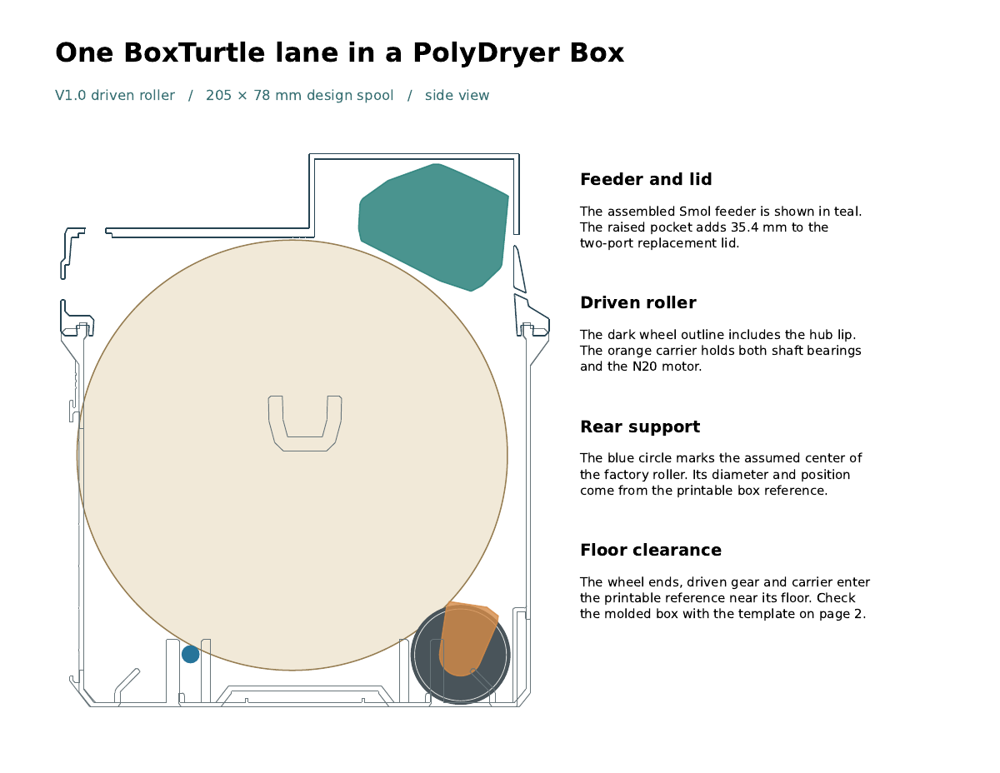

# Poly-Turtle

One BoxTurtle filament lane in a removable, single-spool Polymaker PolyDryer Box. The priorities are to reuse the donor rubber tires, shaft, gears, motor, extruder components and PREP/LOAD switches, keep the spool chamber sealed, and preserve the dryer's docking and airflow.

**Current stage: CAD fit study and bench carrier.** The driven parts fit the V1.0 carrier in CAD. The modeled wheel ends and gear interfere with the floor of a third-party printable body. The original molded box still needs measuring. A raised replacement lid clears the assembled feeder in the modeled pose. A working conversion has yet to be built or tested.

## Start here

- [Illustrated caliper guide and full-size roller template](docs/PolyDryer-Caliper-Guide.pdf). Page 2 prints at 100% on US Letter landscape. Pages 3–6 show where to measure and record readings.
- [Complete fit-study download](downloads/PolyDryer-BoxTurtle-Fit-Study.zip). Includes the registered STEP/STL geometry, guide, notes and BoxTurtle license.
- [CAD file directory](cad/) and [fit findings, assembly instructions and attributions](docs/fit-study.md).
- [Project handoff](docs/handoff.md) for design decisions, unverified assumptions and what to do after measuring the stock box.
- [Build sources and reproduction instructions](build/README.md).

Dimensions are in millimeters. The file marked PROXY represents a third-party printable body. The stock-lid free-volume STEP is a solid representation of empty space.
