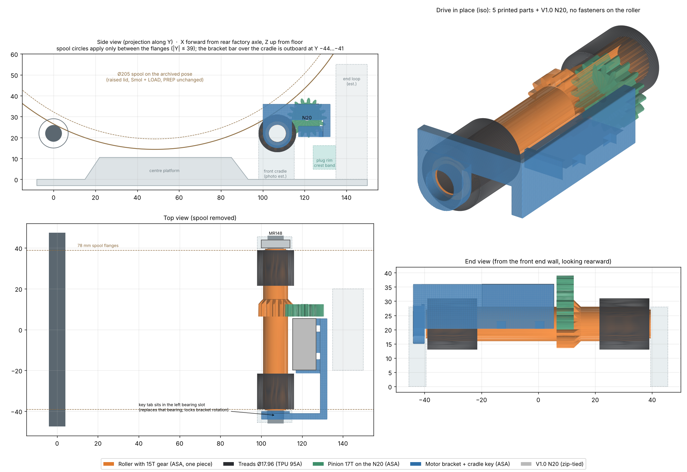

# Cradle drive — revision 2c (fewest parts, no fasteners on the roller)

The molded box measurements ruled out the original drive position at x = 128.57. The ±42 wheel tracks run through the factory front bearing cradles, and the stock wheel lips sit 7 mm into the floor. The respool drive now sits in the factory front-roller position. The spool keeps the archived pose. The lid, Smol, PREP and filament path are covered in [printed-lid.md](printed-lid.md) (rev 3: one-piece lid, feeder re-posed uphill; the spool pays out up its +X side). The BoxTurtle lane LED is removed.

Revision 2c simplifies the build:

- **One printed roller** carries the gear and both TPU treads, and it runs straight on the factory Ø8 rod. Torque goes from the motor to the pinion, then the roller gear, then the treads, and never passes through the rod. There are no grub screws, no drilling or tapping, no press-fit gear and no spacer.
- **Motor drops in from above** onto an open-top bracket and is held by 2 zip ties. To swap it, cut the ties and lift it out without touching the roller.
- **Rewind speed is back to 93 % of V1.0**, with a printed 15T/17T m1 pair. The pair has zero interference over a full tooth cycle and 0.25 mm tip-to-root clearance.
- **The tightest spool clearance improves from 1.98 to 5.48 mm**, because the smaller gear sits well inside the filament wind.
- **One script builds both gear sets.** The V1.0-pinion option is `--gearset v1pinion`.

## Parts

| Part | Qty | Source |
|---|---:|---|
| Roller with 15T m1 gear (`07a-Roller-with-gear.stl`) | 1 | Print in ASA, upright, with the bearing-side end (+Y) on the bed. A 45° chamfer supports the teeth, so no supports are needed. |
| Treads, OD 17.96 / ID 11.6 / 17.5 long (`07b-Tread-sleeve-TPU-L/R.stl`; L = key side, R = bearing side) | 2 | Print in TPU 95A, upright, 100 % infill. Press them onto the roller. |
| Pinion 17T m1, N20 D bore (`07c-Pinion-17T-N20.stl`) | 1 | Print in ASA, flat. |
| Motor bracket with cradle key (`07d-Motor-bracket-cradle-key.stl`) | 1 | Print in ASA **on its side**, with the flat +X end face (745 mm²) on the bed. Add one small support under the key tab's +X edge (3 × 13 mm); everything else prints unsupported. Don't print it upside down: the motor floor would be a 12 mm one-sided overhang. |
| N20 motor | 1 | V1.0 |
| Ø8 rod and the bearing-side bearing | 1 | The factory front roller. Only the key-side bearing comes off. |
| Small zip ties | 2 | — |

That is 5 printed parts, the V1.0 N20, the factory rod and bearing, and 2 zip ties. The V1.0 MR148s are spares. If the factory bearing won't come off the rod, a V1.0 MR148 on a new Ø8 rod (about 88 mm, cut to the factory length) does the same job. Print the rigid parts in ASA, ABS or PC. PETG softens near the dryer's top settings.

**V1.0-pinion option** (`cad/07-cradle-drive/v1-pinion-variant/`). This keeps the V1.0 15T m0.75 pinion on the N20 and prints a 30T m0.75 gear into the roller at the V1.0 centre distance of 17.10 mm. Rewind drops to 41 % of V1.0, and the gear comes within 1.98 mm of a full spool. Use it only if you'd rather not pull the pinion off the N20.

## Assembly

**Key side** is the front cradle you pick for the bracket's key tab. **Bearing side** is the other front cradle. In the CAD the key side is −Y. To build it the other way round, mirror the printed parts about Y = 0.

1. Lift out the factory front roller and slide the bearing off its key-side end.
2. Push the key-side rod end through the bracket's key bushing.
3. Press both TPU treads onto the roller. Turn the roller so the gear, which sits a little off centre, is on the bearing side, with the 45° chamfer facing the bearing end. Slide it onto the rod from the bearing end. The key-side tread passes the motor floor with 1.0 mm to spare.
4. Lower the rod into both cradles: the bearing goes into the bearing-side slot and the key tab into the key-side slot. The bar lies on the cradle top.
5. Press the pinion onto the N20 shaft so it sits 1 mm from the gearbox face, as on V1.0. A 1 mm shim makes this easy. For the V1.0-pinion option, leave the V1.0 pinion as it is.
6. Lower the N20 straight down onto the motor floor with the gearbox face toward the gear. On the way down it never gets closer to the gear than its final centre distance, so turn the roller slightly to line up the teeth. Fasten it with zip ties through the two floor slots, one around the gearbox and one around the can. The can end rests against the rear stop.
7. Turn the roller by hand to check the mesh and free payout.

**Service.** For the motor, cut the two ties and lift it out. For the treads, lift the rod out of the cradles, then slide off the bearing and the roller.

The N20 leads run up the front end wall to the lid harness. Without the LED, the lid harness carries stepper (4), LOAD (2), PREP (2) and N20 (2). Remove the lane LED from the AFC configuration.

## Checks (`checks.json`, fast gear set)

| Check | Min (mm) |
|---|---:|
| Roller gear tips to a full Ø195 filament wind | 5.48 |
| Roller core to the spool flange | 2.98 |
| Bracket / N20 envelope / pinion to spool | 11.7 / 7.5 / 6.7 |
| Bracket to rotating parts outside the bushing / bushing radial play | 4.0 / 0.15 |
| N20 envelope to rotating parts | 2.5 |
| N20 to bracket (seated) / zip-tie gap beside the motor | 0.05 / 1.98 |
| Pinion to bracket overall / to the bracket floor (axial) | 1.01 / 1.0 |
| 15T/17T mesh over a full tooth cycle: interference / min flank gap / tip-to-root | 0.000 / 0.11 / 0.25 |
| Pinion to plug-rim crest band / to estimated end-wall loop | 4.1 / 4.4 |
| Bracket to estimated end-wall loop (P ≈ 24) | 2.7 |
| Bar to cradle top (resting) | 0.4 |
| Assembly: treads passing the motor floor | 1.0 |
| Axial gaps: key to roller / roller to bearing | 0.5 / 0.5 |
| Spool tangency on the rear roller and tread | 0.000 |

The v1pinion results are in `cad/07-cradle-drive/v1-pinion-variant/checks.json`. Neither gear set has a negative clearance. Photo estimates (±2–3 mm) give the molded-feature positions. Of the measured values, only the crest height (16.2) and the cradle top (28) are used.

## Measurements that confirm or adjust this revision

The [picture guide](measurements/finalize-guide.md) shows where and how to take each of these. A [printable PDF with a record sheet](PolyDryer-Finalize-Guide.pdf) is also available. The limits below come from `finalize_guide.py`, which computes them from the design parameters.

1. **Roller pitch** = (A + B) / 2, where A is the outside span across both rods and B is the inside span between them, read at three stations. This sets the tread OD: 106 → 16.91, 107 → 17.96, 108 → 19.02, 109 → 20.09. Anything from 104 to 110 passes every check once `PITCH` is set. Below 105 the TPU tread wall gets thin.
2. **Front cradle slots**:
   - E, the bearing outer faces measured on the bench: ≈ 88
   - S, the key-side slot width: 13.9–14.4
   - H, slot top to slot bottom: ≈ 13
   - T, plate thickness: record it
   - F, between the inboard plate faces below the slots: ≥ 79
3. **Factory front rod**: length L ≥ E and diameter d = 8.0. Also note whether the key-side bearing slides off.
4. **Clear space in front of the front rod**: P, from the rod front surface to the first surface in front of it (the end-wall loop, or the end wall where there is no loop), must be ≥ 22.3 at the key side, the centre line and the bearing side. The layout was drawn for about 24. Also take six bridge depth readings, 8 and 16 mm in front of the rod front surface. Every depth must be ≥ 162, which means nothing rises above Z 19.
5. **Rear-wall gap W** at spool-centre height, with your largest spool on the stock rollers: W ≥ 6.1. The cradle drive moves the spool 5.1 mm toward the rear wall.

Bench-test free payout, roller spin on the rod, and loaded rewind before running AFC.

## Files

| File | What |
|---|---|
| `cad/07-cradle-drive/*.stl`, `checks.json`, `layout.json` | Printable parts in box coordinates (X forward from the rear factory axle, Z up from the floor, mm), with their checks |
| `cad/07-cradle-drive/v1-pinion-variant/` | The same files for the V1.0-pinion option |
| `cad/07-Cradle-drive-layout.step.zip` | Assembly STEP: spool, rear roller, Smol with LOAD, PREP, paths, V1.0 N20 and the bearing. The Smol, PREP and paths are in the rev 3 printed-lid pose (45°, uphill), so the STEP lines up with cad/08. In Fusion, use *Insert Mesh* without moving the STLs to place them on it. |
| `build/cradle-drive/` | Scripts that regenerate everything (numpy, scipy and matplotlib only) |
