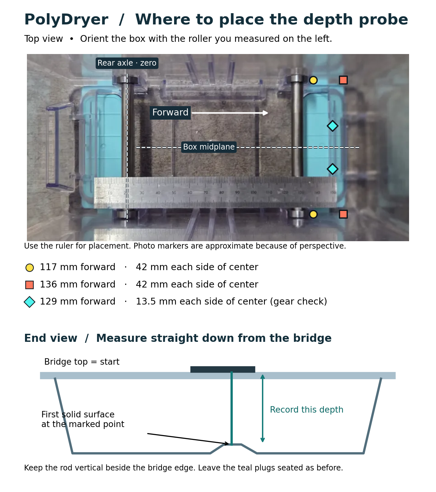

# Molded PolyDryer Box measurements — 2026-11-24

Use the interior floor at the user's height measurements as z = 0. Positive z is up. Forward distance x starts at the retained rear factory axle and increases toward the proposed drive. Lateral offsets are from the spool midplane. All units are mm.

| Feature | Value | Basis |
|---|---:|---|
| Rear roller running diameter | 8 | User's pin reading, interpreted as the exposed spool-contact rod visible between the bearings |
| Bearing outside diameter | 14 | User's reading, one bearing at each end |
| Rear roller crown | z = 26 | User |
| Rear axle / roller underside | z = 22 / 18 | 26 minus radius 4 / diameter 8 |
| Bearing top / bottom | z = 29 / 15 | Concentric with axle, radius 7 |
| Bearing support tops | z = 28 | User |
| Installed teal vent plug tops | z = 4.8 | User; removable gasketed closures |
| Wave crest above plug | about 11.36 | User; taken as vertical |
| Wave crest above floor | about 16.2 | 4.8 + 11.36 |
| Factory roller center spacing | about 106–109 | Spread of ruler-photo readings, not a tolerance |
| Factory front axle to proposed drive axle, forward | about 20–23 | 128.57 minus photo-estimated pitch |

## Reading the ruler
In the level end-on view with the ruler immediately below the bearing faces, the centers project to roughly 21 and 127 mm (pitch 106). In the overhead view with readable graduations they project to roughly 21 and 128 (pitch 107). The other end view with the ruler above the faces reads about 26 and 135 (pitch 109). The ruler and features occupy different planes. Use nominal pitch 107 for an exploratory sketch. For a mounting dimension, measure the outside span across both rods near the same end and subtract 8 if both rods measure Ø8.

## Consequence for file 01 and the printed template
The original driven axis is (x,z) = (128.57,21.73), using the original vertical offset of −0.27. The Ø47.6 lip bottoms at z = −2.07 and the Ø43.76 tread at z = −0.15. On a continuous floor at z = 0 this pose interferes even before adding running clearance. For a local floor elevation h directly below the axle in a wheel-lip track, the driven axle must be at least h + 23.8 + desired running clearance. Elsewhere along the circle the lower edge rises away from the axle. An opening at a track changes the result; a rib there can increase interference. The crest height alone does not locate a collision. Keep vent and plug-access space available. A drive relocation changes spool seating and requires a fresh lid, end-wall and feeder check.

## Bridge readings at x = 129 mm
Rear roller crown depth C = 155 mm. Surface depth F = 176 mm on both sides, taken as the requested L42 and R42 tracks. Depths increase downward. Each surface sits 21 mm below the crown, 17 mm below the rear axle and 5 mm above the earlier floor datum. The x = 129 readings do not identify the contacted feature. At the trial axle height, the lip overlaps each sampled surface by about 7.1 mm (23.8 mm lip radius minus 16.73 mm axle-to-surface height; the 0.43 mm longitudinal offset changes this by less than 0.01 mm). This rules out the current pose with the measured surfaces in place. Raising the drive by about 7.1 mm gives tangency only at the two sampled points. Check adjacent stations, gear tracks and spool pose before selecting a revised axle height.

## Smaller driven wheels proposed for the next trial

Ryan can print replacement tires. The proposed wheel uses a Ø30 rigid lip and Ø28 TPU tread on the existing Ø8 shaft. At the 129 mm outer-track readings the lip has about 1.7 mm nominal clearance (16.73 − 15). Only these two points have been checked. Keep the existing gear size in the interference check. A smaller tire alone leaves the Ø47.6 lip unchanged.

For the modeled Ø205 spool, assuming circular flanges tangent to both rollers, unchanged axle positions, and no tread compression, the spool center shifts about 7.4 mm toward the drive and 4.1 mm down relative to the stock-tread trial. At equal shaft RPM the nominal rewind surface speed is 28 / 43.76, about 64% of the original. Wheel retention, tire grip, gear and carrier clearance, wall and lid fit, and loaded rewind still need verification. The archived STEP files show the original trial. No smaller wheel or tire has been fabricated or tested in this study.

## Next six probe readings

Use the same rigid bridge across the flat lid-seating ledges on the two long walls as for the 155 mm crown reading. Keep the bridge at the same elevation as you move it. Measure forward from the rear axle and sideways from the box midplane. Probe vertically beside the bridge edge from the bridge top to the first solid surface. Keep both gasketed plugs seated. Record the surface touched at each point, or OPEN plus the nearest solid edge.

| Marker | Forward | Offset either side | Left depth / surface | Right depth / surface |
|---|---:|---:|---|---|
| Yellow, wheel lip | 117 | 42 | Pending | Pending |
| Red, wheel lip | 136 | 42 | Pending | Pending |
| Teal, gear track | 129 | 13.5 | Pending | Pending |

For a lip of radius r, its lower edge at a forward station x within its radius is at bridge depth 159.27 + sqrt(r² − (x − 128.57)²). Subtract that depth from the measured surface depth to obtain vertical clearance. Smaller depths indicate a higher obstruction. Check the gear using its own CAD profile. Include the rest of the [guide grid](../PolyDryer-Caliper-Guide.pdf), including x = 145 where applicable, when shaping the carrier. Record actual spool OD and width, opposite-wall gap at spool-center height, spool rise, and closed-lid roof clearance before freezing the layout.

## Photo-derived estimates — 2026-11-25

These are exploratory estimates from the existing photos. They are not probe readings. Scale comes from the ruler tick pitch in the overhead view (3.49 px/mm by FFT), the Ø14 bearing in the end view (about 6.4 px/mm), and the known z = 22 axle and z = 28 support tops. These cross-check within about 1 mm. Expect ±2–3 mm error from perspective. Clear molded features at different lateral depths overlap in the end views.

| Feature | Estimate | Source |
|---|---:|---|
| Rear / front factory axle on overhead ruler | 21.7 / 128.0 → pitch about 106.3 | 1000017854.jpg, tick-calibrated |
| Factory bearing lateral position | about ±42 from midplane | Overhead, bearing centers 295 px apart |
| Front bearing cradle, forward face | x ≈ 115 (front axle + 8.5–9), solid from floor to top z = 28 | End view 1000017858.jpg; overhead clear block beside the bearing |
| Cradle block lateral extent | about 30–45 mm each side of center | Overhead |
| Front plug well (teal top z = 4.8) | x ≈ 110 to 125 open teal; clear rim/frame to x ≈ 134–135 | Overhead teal mask |
| End-wall loop / bracket | x ≈ 135–150, central band about ±20 | Overhead and end view |

### Predicted probe readings (bridge top at z = 181, so depth = 181 − z)

| Marker | Predicted surface | Predicted depth | Confidence |
|---|---|---:|---|
| Yellow 117, ±42 | Plug-well floor/plug top, about 2 mm forward of the cradle face. If the rod touches the cradle, it reads about 153. | ≈ 176 | Low. Station sits on a 23 mm step. |
| Red 136, ±42 | Just past the rounded corner of the plug rim: well floor or rim slope | 165–176 | Low |
| Teal 129, ±13.5 | Clear plug-rim band (x ≈ 125–135 near center): rim up to the z ≈ 16.2 crest, or plug top | 165–176 | Low |

Use these readings to prepare for the probes. Do not use them in place of probes.

### Finding that does not depend on the six probes

The ±42 wheel-lip tracks run through the factory front bearing cradles. With the axle at (128.57, 21.73), the Ø30 lip reaches back to x = 113.6 at z = 21.7. The cradle face is at x ≈ 115 and its top is at z = 28, so the overlap is about 1.4 mm horizontally at lip-center height. The Ø47.6 stock lip reaches back to x = 104.8 and overlaps the cradle and the front factory roller by much more. With the front roller still installed, the Ø30 lip is about 0.3 mm from its Ø14 bearing (x ≤ 113.3). Unless the cradle is cut, the axle must move forward to about x ≥ 131 for a Ø30 lip with 1 mm clearance. That move takes the lip front to x ≈ 146, toward the end bracket. Alternatively, move the wheel tracks inboard of the cradle (|y| < 30), but this misses 78 mm spool flanges at ±37–39. When probing, also measure (a) the cradle's forward face x and top z at ±42 and (b) the x and z of the plug-rim crest at ±42 and ±13.5. See [photo-profile-estimate.png](photo-profile-estimate.png) for both lip circles drawn on the calibrated end view.

## Evidence and references

- Eight [original photos](photos/) show the roller spacing, bearing seats, curved ribs and installed teal plugs. The annotated diagram uses the overhead view 1000017854.jpg. Photo estimates are suitable for an exploratory layout.
- David Gougerdi’s GrabCAD listing (October 28, 2025) lists Polydryer.step and Polydryer.f3d. Its preview appears to depict the dry dock with two air ports. Download required sign-in; the solids were not inspected. Its value for dock registration remains provisional. If a STEP becomes available, check for an actual box interior and compare the 21 mm crown-to-surface drop at x = 129, ±42 before using it for other points. [GrabCAD files](https://grabcad.com/library/polydryer-box-1/files)
- The [original study and upstream attributions](../fit-study.md#sources-and-attribution) identify the BoxTurtle donor hardware, stock-lid volume, desiccant groove reference, printable proxy body and replacement lid. The [physical measurement guide](../PolyDryer-Caliper-Guide.pdf) includes the full-size template. [Polymaker’s manual](https://polymaker.com/wp-content/uploads/User-Manual-1117_20240605.pdf) describes installing the airlocks after removing the box from the dock.
