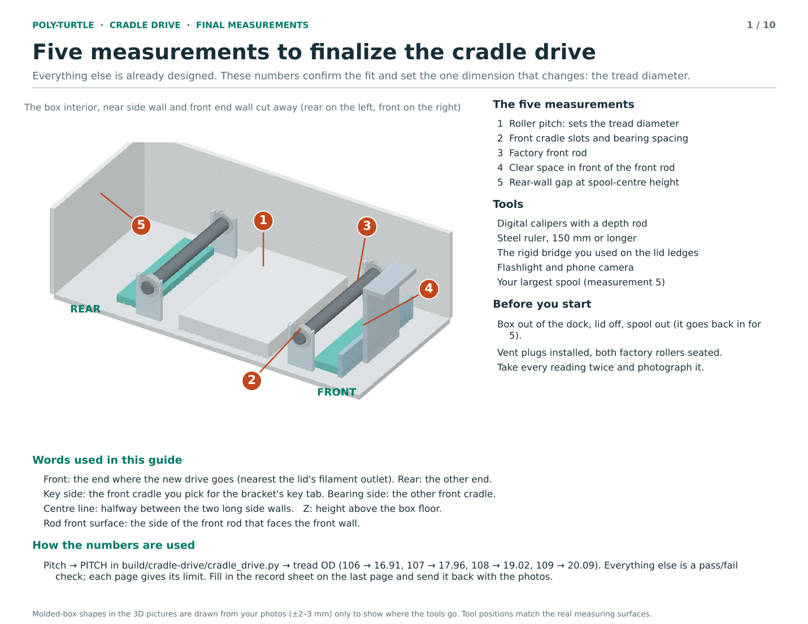
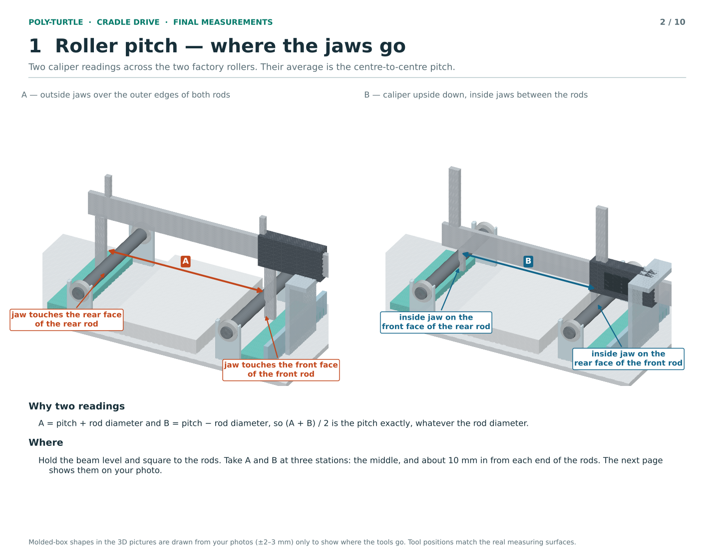
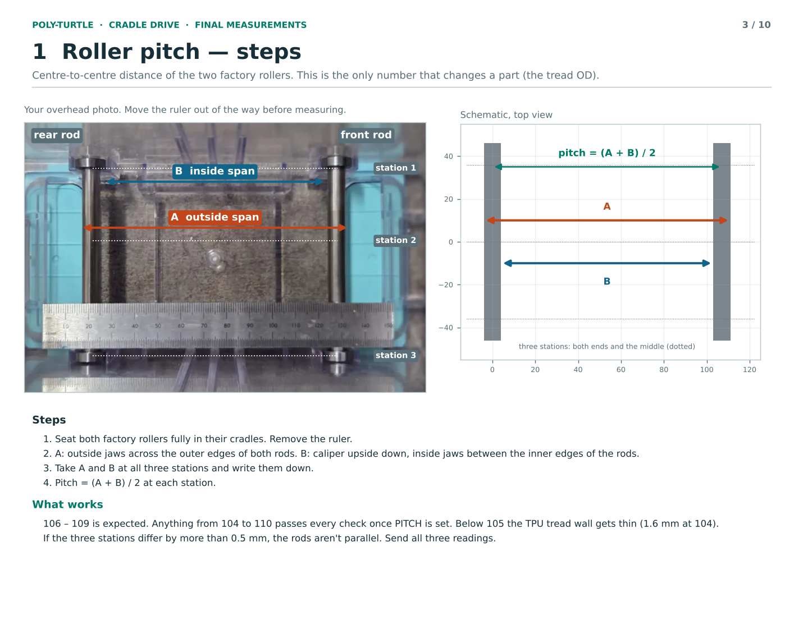
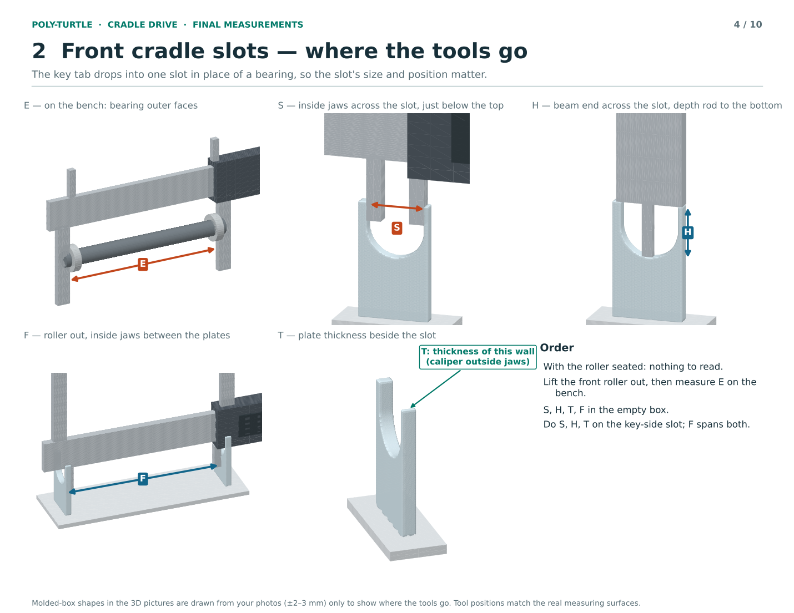
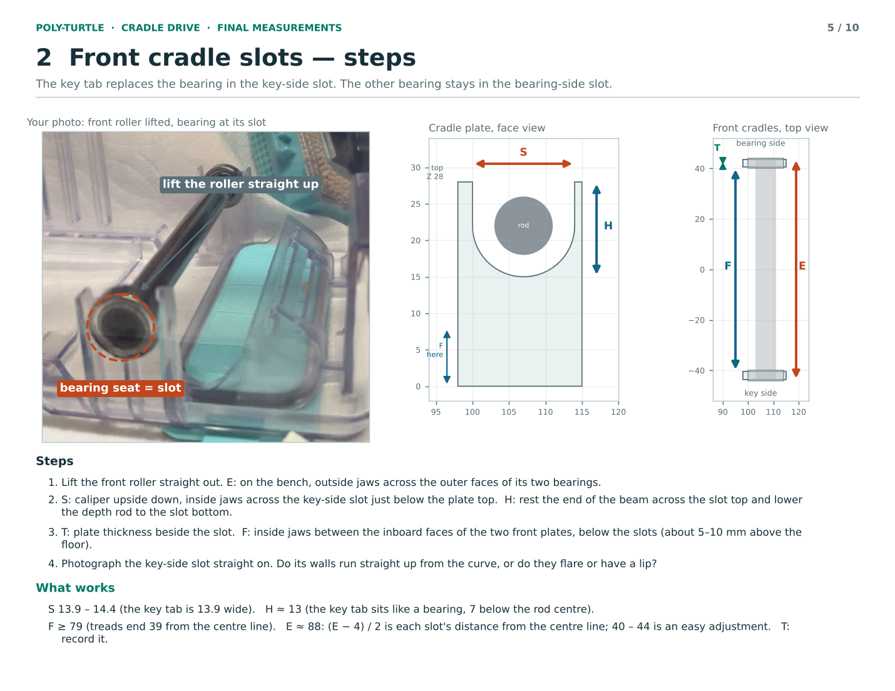
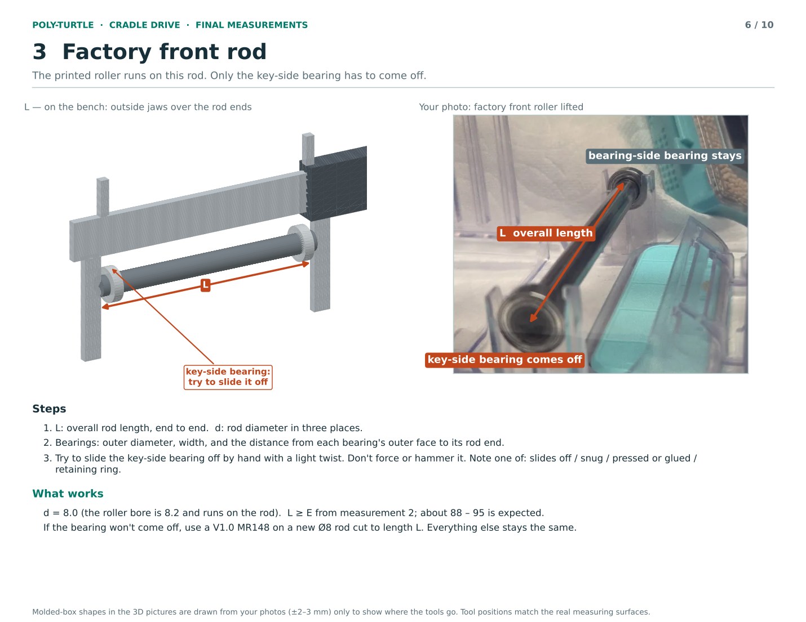
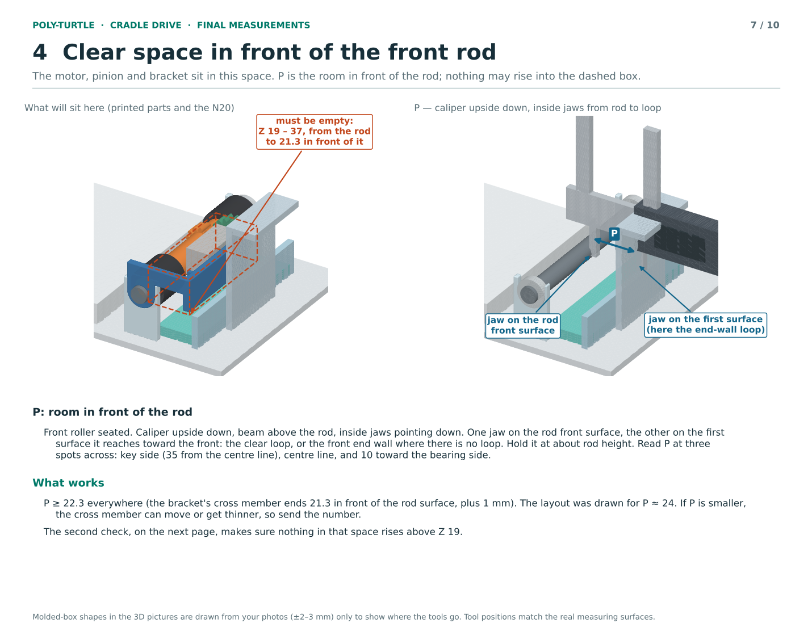
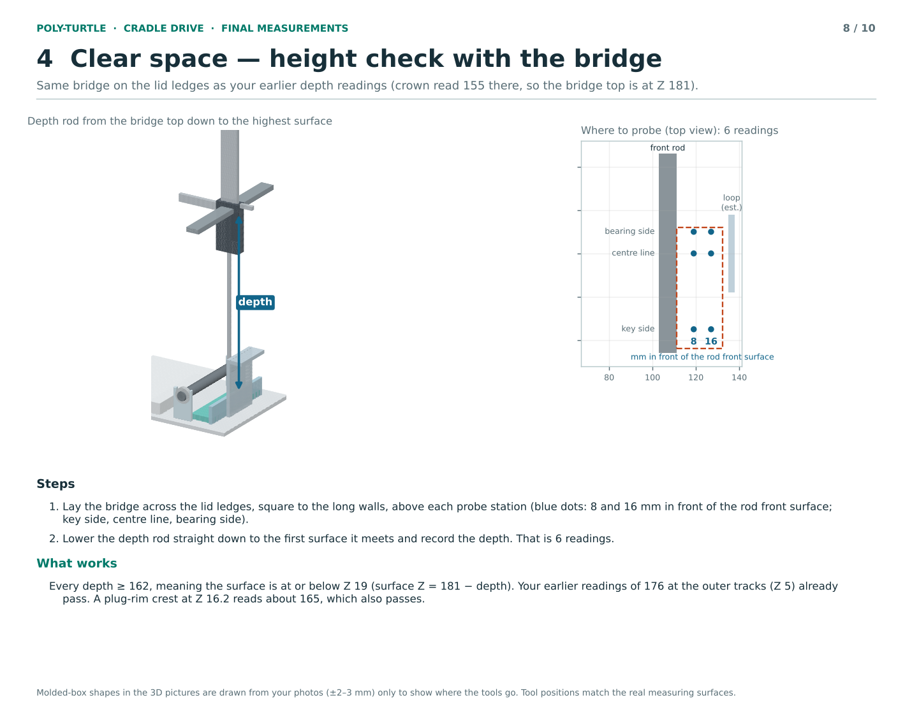
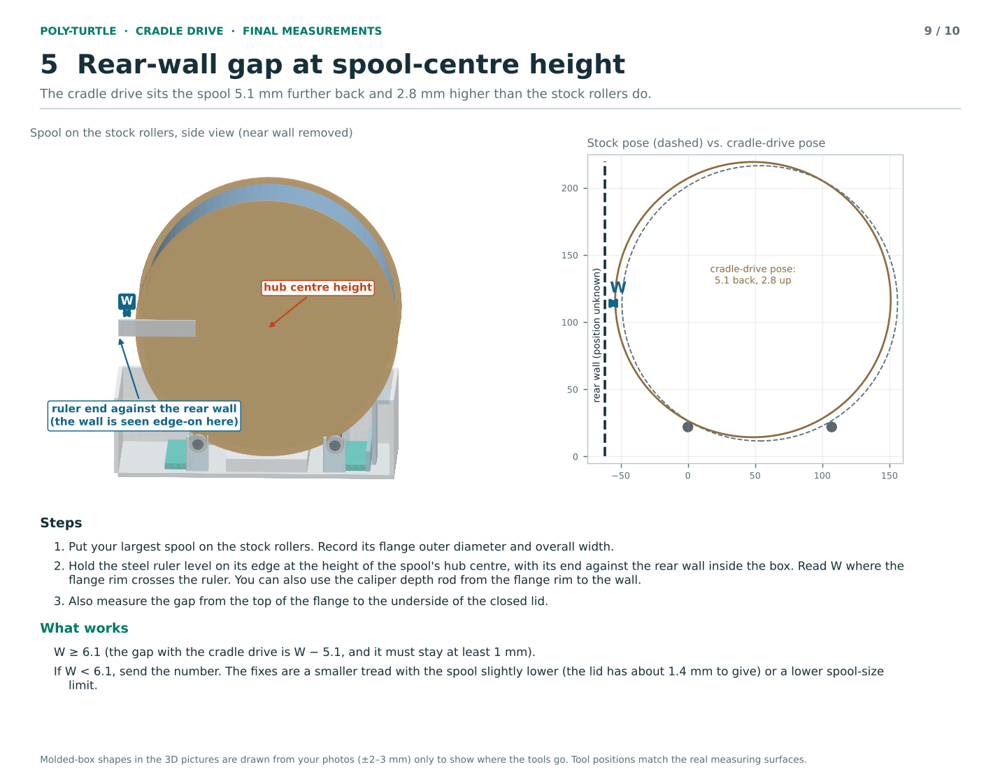
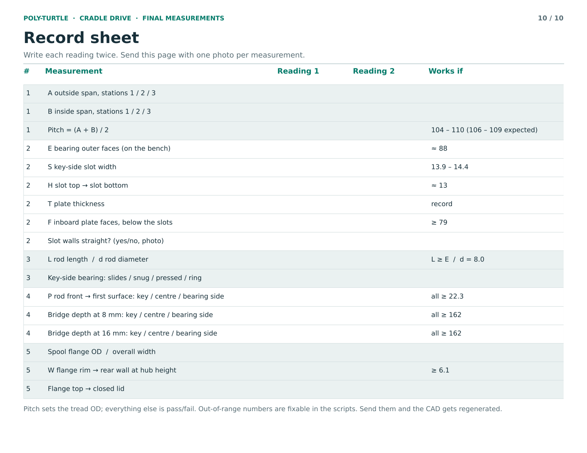

# Final measurements for the cradle drive

Five measurements finalize the [cradle drive](../cradle-drive.md). The roller pitch sets the tread diameter. The rest are pass/fail checks against the parts as they are now. Print the [PDF version](../PolyDryer-Finalize-Guide.pdf) and fill in the record sheet on its last page, or work from this page. The PDF and these pictures come from the same pages, generated by `build/cradle-drive/finalize_guide.py`, which computes every limit from the design parameters.

**Words used throughout**
- **Front** is the end where the new drive goes, nearest the lid's filament outlet. **Rear** is the other end.
- **Key side** is the front cradle you pick for the bracket's key tab. **Bearing side** is the other front cradle.
- **Centre line** is halfway between the two long side walls. **Z** is height above the box floor.
- **Rod front surface** is the side of the front rod that faces the front wall.

**Tools:** digital calipers with a depth rod, a 150 mm or longer steel ruler, the rigid bridge you used on the lid ledges, a flashlight, and your largest spool (for measurement 5).

**Before you start:** take the box out of the dock and remove the lid and spool. Leave the vent plugs installed and both factory rollers seated. Take every reading twice and photograph each one.

The molded-box shapes in the 3D pictures come from your photos (±2–3 mm) and only show where the tools go. The tool positions match the real measuring surfaces.

## 1. Roller pitch
A: outside jaws across both rods. B: caliper upside down, inside jaws between them. Pitch = (A + B) / 2, so the rod diameter cancels out. Take both at three stations (the middle and about 10 mm in from each end). 106–109 is expected, and anything from 104 to 110 works.

## 2. Front cradle slots
| Reading | How | Works if |
|---|---|---|
| E | Bearing outer faces, on the bench after lifting the roller out | ≈ 88 |
| S | Key-side slot width, inside jaws just below the top | 13.9–14.4 |
| H | Beam end across the slot top, depth rod to the slot bottom | ≈ 13 |
| T | Plate thickness | Record it |
| F | Between the inboard plate faces, below the slots | ≥ 79 |

Also photograph the key-side slot straight on.

## 3. Factory front rod
Measure the rod length L (works if ≥ E) and its diameter d (works if 8.0). Then try to slide the key-side bearing off by hand; don't force it. If it won't come off, use a V1.0 MR148 on a new Ø8 rod cut to length L.

## 4. Clear space in front of the front rod
P: caliper upside down, with one inside jaw on the rod front surface and the other on the first surface it reaches toward the front (the end-wall loop, or the end wall where there is no loop). Take it at the key side, the centre line and the bearing side. Works if P ≥ 22.3 everywhere (the layout was drawn for about 24).

Bridge depths: from the lid-ledge bridge (top at Z 181), take six depth readings 8 and 16 mm in front of the rod front surface. Works if every depth is ≥ 162, which means nothing rises above Z 19.

## 5. Rear-wall gap at spool-centre height
Put your largest spool on the stock rollers. At hub-centre height, measure W from the rear wall to the flange rim. Works if W ≥ 6.1, because the cradle drive moves the spool 5.1 mm toward the rear wall. Also record the flange OD and overall width, and the gap from the flange top to the closed lid.

## Record sheet

Send the readings and photos back, and the CAD gets regenerated from them (`build/cradle-drive/`).
