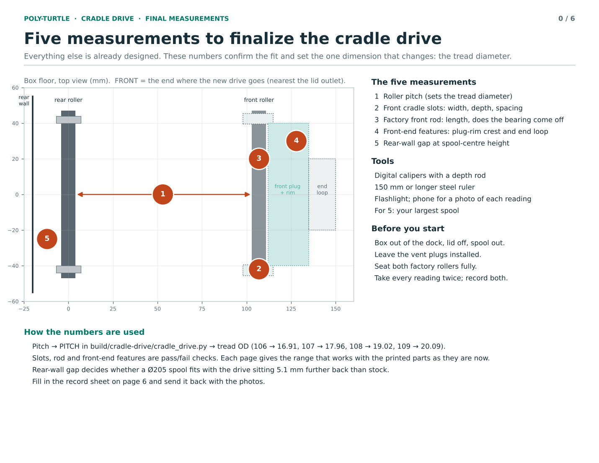
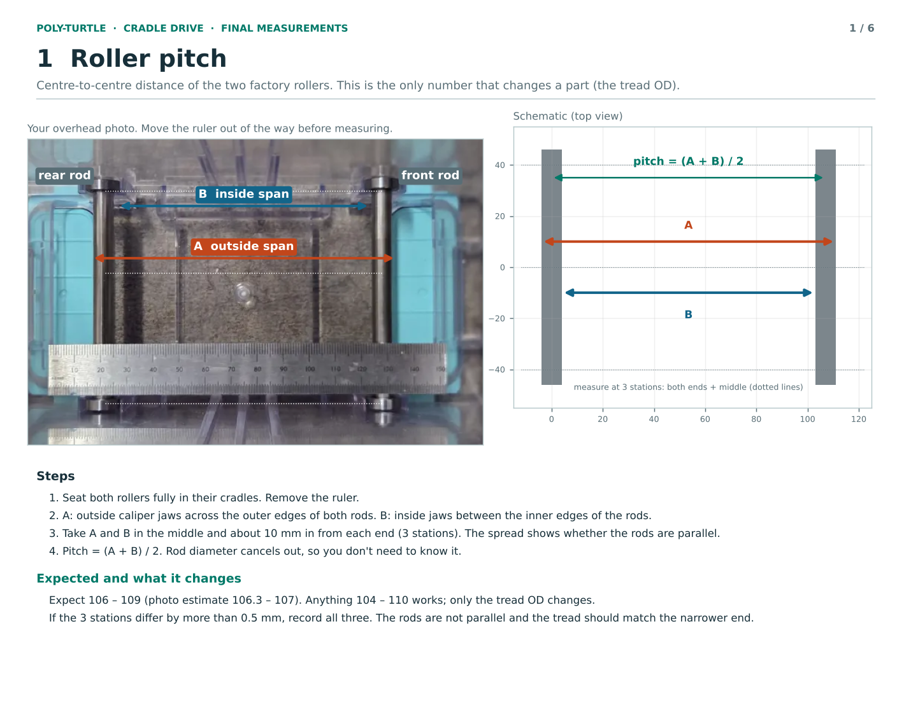
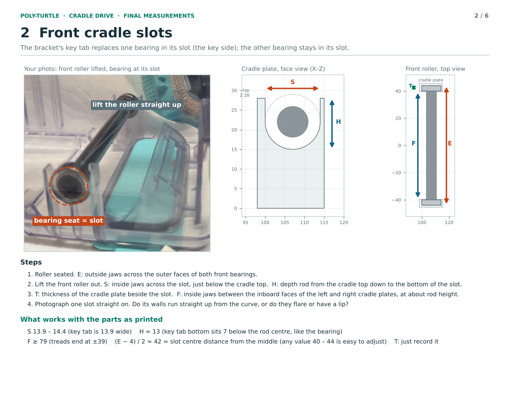
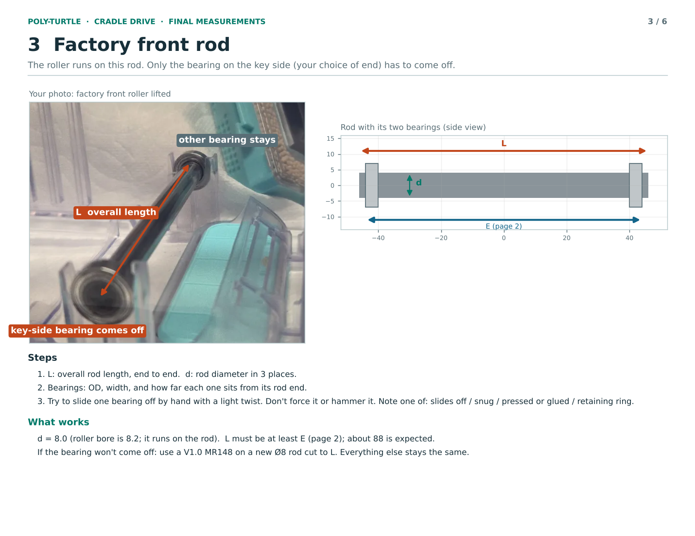
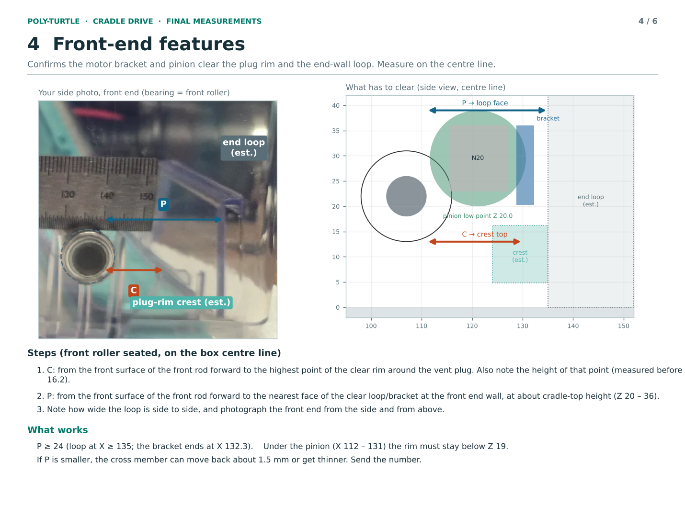
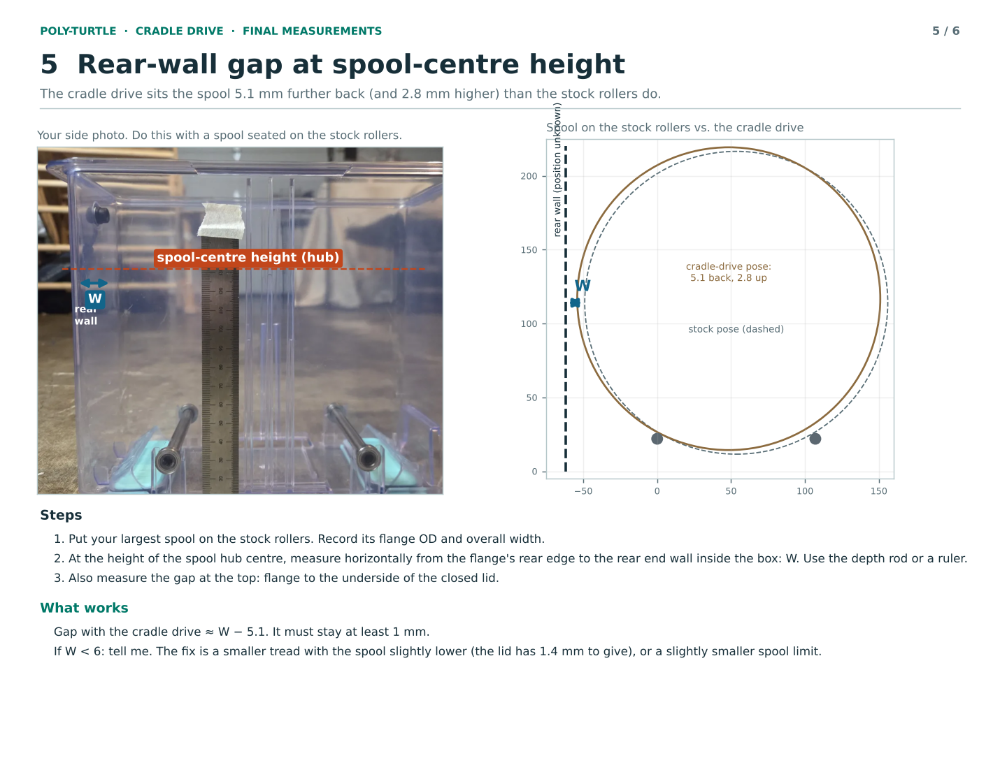
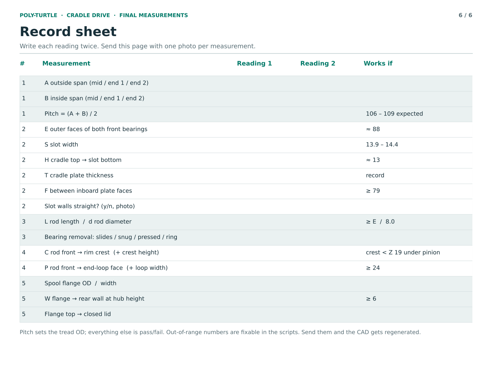

# Final measurements for the cradle drive

These five measurements finalize the [cradle drive](../cradle-drive.md). The roller pitch sets the tread diameter. The rest are pass/fail checks against the parts as they are now. Print the [PDF version](../PolyDryer-Finalize-Guide.pdf) and fill in the record sheet, or work from this page.

Tools: digital calipers with a depth rod, a 150 mm or longer steel ruler, a flashlight, and your largest spool (for measurement 5). Take the box out of the dock and remove the lid and spool. Leave the vent plugs installed and both factory rollers seated. Take every reading twice and photograph each one.

**Front** is the end where the new drive goes, nearest the lid outlet. The **key side** is whichever cradle you choose for the bracket's key tab. The parts mirror for the other side.

## 1. Roller pitch

A: outside jaws across both rods. B: inside jaws between them. Pitch = (A + B) / 2, so the rod diameter cancels out. Measure in the middle and near both ends. Expect 106–109. The pitch sets `PITCH` and the tread OD (106 → 16.91, 107 → 17.96, 108 → 19.02, 109 → 20.09).

## 2. Front cradle slots

E: outer faces of both front bearings, with the roller seated. With the roller lifted out:
- S: slot width (works if 13.9–14.4)
- H: cradle top to slot bottom (≈ 13)
- T: plate thickness
- F: between the inboard plate faces (works if ≥ 79)

Also photograph one slot straight on.

## 3. Factory front rod

Measure the rod length L (works if ≥ E) and its diameter d (works if 8.0). Then note whether the key-side bearing slides off by hand. Don't force it. If it won't come off, use a V1.0 MR148 on a new Ø8 rod cut to L.

## 4. Front-end features

On the centre line, measure from the front surface of the front rod:
- C: forward to the highest point of the plug rim, plus that point's height. Under the pinion (X 112–131) the rim must stay below Z 19.
- P: forward to the face of the end-wall loop, at Z 20–36. Works if P ≥ 24.

## 5. Rear-wall gap at spool-centre height

With your largest spool on the stock rollers, measure W at hub-centre height: from the flange's rear edge to the rear end wall. The cradle drive sits the spool 5.1 mm further back, so W must be at least 6. Also record the spool's flange OD and width, and the gap from the flange top to the closed lid.

## Record sheet

Send the readings and photos back, and the CAD gets regenerated from them (`build/cradle-drive/`).
