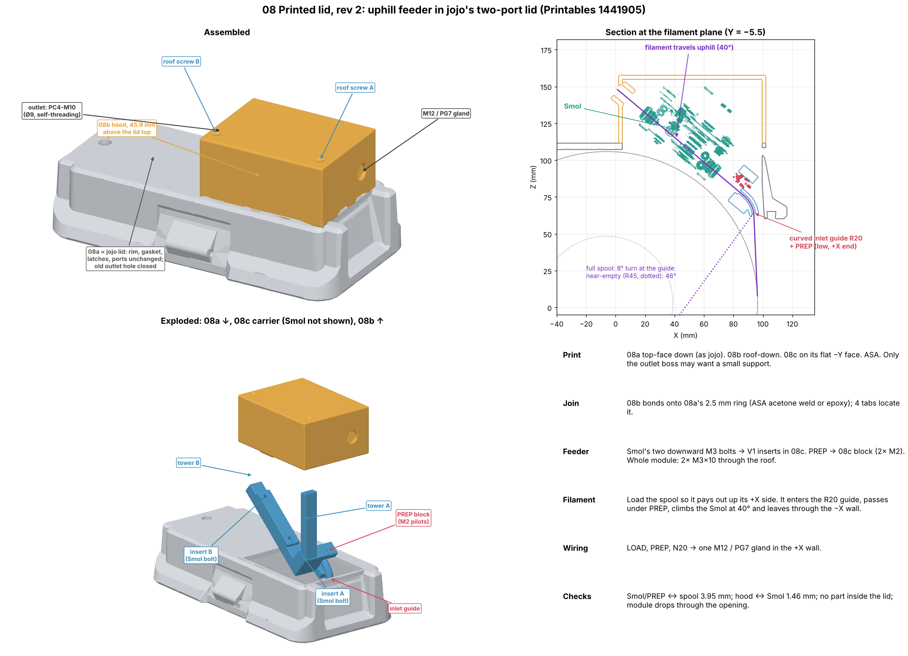

# 08 Printed lid (rev 2: uphill feeder)

**The conversion needs a printed lid.** The Smol feeder (with LOAD) and the PREP switch sit above the top of the box, so the stock lid can't close over them. The printed lid is jojo's two-port **Printed Lid for Polydryer Box** ([Printables 1441905](https://www.printables.com/model/1441905), CC BY-NC-SA, based on work by Extrutim and Cipism). The old `cad/05` clearance shell was this lid with a capped box on top. Rev 1 turned that shell into printable parts.

**Rev 2 re-poses the feeder so filament travels uphill.** In the archived pose, the PREP inlet sat at the high end of a feeder tilted downward. Filament from the spool would have had to turn about 110° within a few millimetres to reach it. Rev 2 turns the Smol and PREP end for end and tilts them so filament climbs the feeder at **40°** toward −X. The inlet is now the low +X end, just above the lid rim. Filament comes up the +X side of the spool into a curved guide, so the turn is gentle. The cost is height: the hood is **45.9 mm** above the lid top instead of 35.4.



Files: [`cad/08-Printed-lid.zip`](../cad/08-Printed-lid.zip) contains the STLs, `checks.json` and `mesh-report.json`. Everything is in the cad/01 and cad/05 model frame (Z up, mm).

| File | Part | Print |
|---|---|---|
| `08a-lid-body.stl` | jojo's lid with the cad/05 pocket clipped flush with the flat top, leaving a 95 × 71 mm opening. The old 4.3 mm outlet hole in the +X end wall is closed. Rim, gasket channel, latches and ports are jojo's original triangles. | Top face down, as jojo intended |
| `08b-hood.stl` | Hood. Holds the PC4-M10 outlet boss in the −X wall (Ø9, the fitting cuts its own thread), the M12 / PG7 gland hole in the +X wall, two roof screw holes and four locating tabs. | Roof down; the outlet boss may want a small support |
| `08c-feeder-carrier.stl` | One piece under the Smol, replacing the BoxTurtle trayframe interface. Rail with two V1 heat-set inserts for the Smol's downward bolts, the PREP block (2 × M2 pilots, Ø1.7), the curved inlet guide (R20, 40°, Ø2.4 bore, flared mouth), and towers A and B up to the roof. | On its flat −Y face, no supports |
| `08-Printed-lid-one-piece.stl` | 08a + 08b as touching shells that the slicer merges. Use it instead of 08a + 08b to avoid bonding, at the cost of supports under the lid plate. | Roof down with tree supports |

ASA is recommended for dryer temperatures.

## Assembly

1. **Bond 08b to 08a.** The hood's 2.5 mm wall sits on the matching ring around the opening, and the tabs locate it. Use an ASA acetone weld, or epoxy for other materials. This joint is permanent and is part of the seal.
2. **Inserts.** Press V1 M3 heat-set inserts into the rail at A and B and into the tops of towers A and B (Ø4.2 × 5.5 holes).
3. **Build the feeder module on the bench.**
   - Thread the Smol's two downward M3 bolts (the ones that went into the trayframe) into the rail inserts. A Ø3.2 relief under each insert takes the existing bolt tails.
   - Screw the D2F PREP switch to the block with 2 × M2 self-tapping screws from below, lever toward the filament.
   - Push a test length of filament through the guide, under the PREP lever and into the Smol inlet. It should run without catching.
4. **Install.** With the lid upside down, lower the module straight through the opening. The module spans x 6.0–97.4 and y −36.5–28.8; the opening is 4.5–99.5 × −39.5–31.5. Fasten it with 2 × M3 × 10 through the roof into the tower inserts, with a washer and a dab of sealant under each head.
5. **Outlet.** Screw a PC4-M10 fitting into the −X boss and run PTFE to the hub. Its axis is the filament axis, so the PTFE runs straight out of the Smol.
6. **Wiring.** LOAD, PREP and the N20 leads leave through the M12 / PG7 gland in the +X wall. Fit a 2-pin plug inside for the N20 so the lid can come off.
7. **Spool.** Load it so filament pays out **up the +X side** (toward the guide). The cradle drive is unchanged and rewinds in the opposite direction.

**Service:** remove two roof screws and the whole feeder module, PREP included, drops out.

## Checks (`build/lid/checks.py`, values from `checks.json`)

Clearances are sampled from vertices and small circles of the cad/01 reference parts, moved into the rev 2 pose. They are not exact solids.

| Check | Result |
|---|---|
| Meshes 08a / 08b / 08c | Closed; every edge shared by exactly 2 faces |
| Smol + PREP to spool envelope (Ø205 × 78) | 3.95 mm |
| Hood / carrier to spool | 3.40 / 3.73 mm |
| Hood to Smol | 1.46 mm (under the roof) |
| Carrier to Smol, excluding the replaced trayframe interface | 0.46 mm, at the rail top where the Smol's base sits |
| Carrier to PREP | 0.20 mm (the switch face sits on the block) |
| Carrier to hood | 0.30 mm (tower tops under the roof) |
| Any part inside jojo's lid solid | 0 points |
| Module drops through the opening | yes; lowest point Z 61.5, 1.3 mm above the lid rim plane |

**Inlet routing.** The table shows the free filament run from the spool to the guide mouth at each spool radius. In every case the path stays inside the lid and 37.7 mm from the Smol.

| Spool radius | Leaves the spool at (X, Z) | Turn at the guide mouth | Path to carrier |
|---|---|---|---|
| 102.5 (full) | 96.3, 7.9 | 7.6° | 1.59 mm |
| 80 | 71.0, −18.1 | 25.6° | 2.01 mm |
| 60 | 47.0, −24.6 | 37.9° | 2.69 mm |
| 45 (near empty) | 30.3, −23.1 | 46.1° | 2.99 mm |

After the mouth, the guide adds a smooth 40° turn at R20. Compare the archived pose, which needed about 110° in a few millimetres.

## Verify on the box

- **Guide mouth.** It sits at box X ≈ 148 (model X 93.8), and the guide's lowest point is 1.3 mm above the lid-rim plane. Check that the inside of the box's +X end wall and the seating lip leave at least 2 mm there, with the lid closed.
- **Payout side.** A full spool pays out close to the +X wall (X 96.3 at the spool's equator). Make sure nothing in the box (plugs, desiccant) sits in that strip.
- **Bench test.** Feed and retract through the module before bonding the hood. Watch for drag at the guide on a near-empty spool.

## Parameters

The pose lives in `build/lid/pose.py`. `ALPHA` and `INLET` are set in `printed_lid.py`, and every carrier and hood feature is defined in the Smol's own frame, so they follow any new pose. `occ.py` and `search.py` reproduce the pose search: minimum hood height subject to ≥ 3.5 mm spool clearance, no lid intersection, and a straight drop through the opening. Steeper angles (37.5–47.5°) give about the same hood height. 40° was chosen for the margin in X.

## Rebuild

```
cd build/lid
python3 clouds.py        # Smol / PREP reference clouds (needs cad/01: python transport/restore.py)
python3 printed_lid.py   # lid body, hood, carrier, one-piece STL (marching cubes, 0.4 mm)
python3 occ.py           # lid occupancy grid from 08a
python3 checks.py        # checks.json and cad/08-Printed-lid.zip
python3 render.py        # docs/printed-lid.png
```

Each derivative file keeps jojo's CC BY-NC-SA license and attribution.
